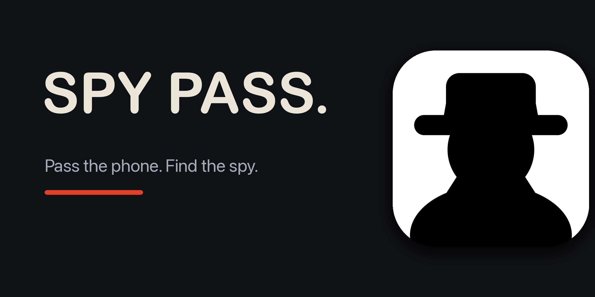
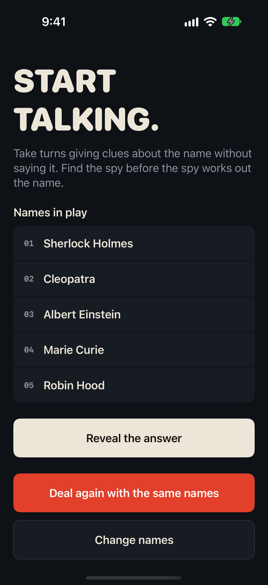

# Spy Pass

Spy Pass is a pass-the-phone party game for three or more players. The app picks one name for the round and assigns one player as the spy. Everyone else sees the name. The spy has to work it out from the group's clues.

The app runs locally on one iPhone or iPad. It has no accounts, ads, analytics, or network features.

## Support and privacy

- [Support](https://davidgamero.github.io/spy-pass/support.html)
- [Privacy policy](https://davidgamero.github.io/spy-pass/privacy.html)
- Email: [david340805@gmail.com](mailto:david340805@gmail.com)

## Project

Open `SpyPass/SpyPass.xcodeproj` in Xcode and run the `SpyPass` scheme.

The App Store metadata and screenshots are stored under `AppStore/`.

## Screenshot

